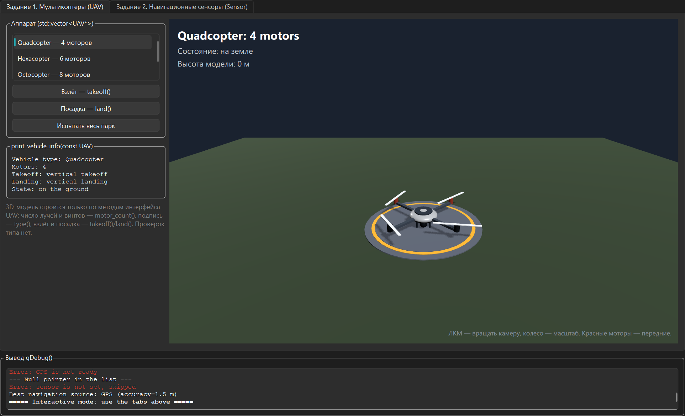
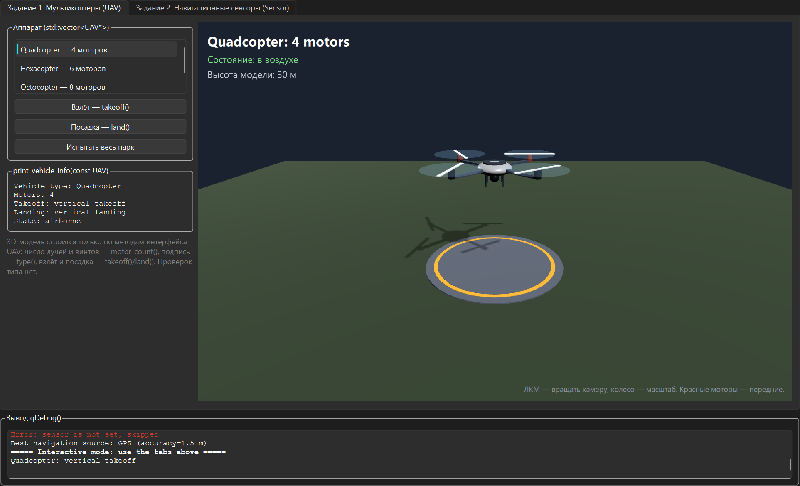
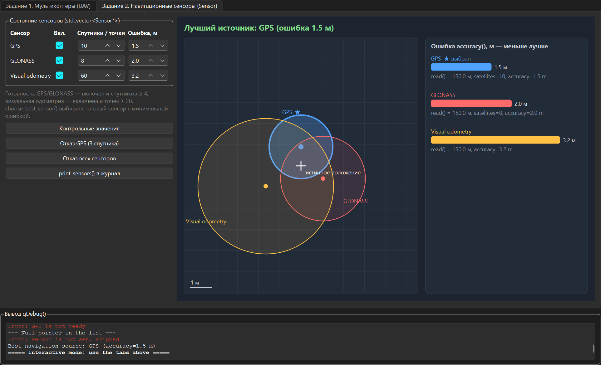

# Контрольная работа №2 — ПО ОНИ, вариант 2 (задания 1 и 2)

Среда: **Qt Creator**, Qt 6.12, MinGW 64-bit, CMake, C++17.

| Файл | Содержимое |
|---|---|
| `uav.h / uav.cpp` | Задание 1: абстрактный `UAV` (+ `motor_count()`), `Multicopter`, `Quadcopter`, `Hexacopter`, `Octocopter`, функции `print_vehicle_info(const UAV&)`, `print_motor_summary()` |
| `sensor.h / sensor.cpp` | Задание 2: абстрактный `Sensor` (+ `accuracy()`), `SatelliteSensor`, `GPS`, `GLONASS`, `VisualOdometry`, функции `print_sensors()`, `choose_best_sensor()` |
| `main.cpp` | Консольные сценарии обоих заданий через `qDebug()`, включая ошибочные ситуации |
| `uav_scene.h/.cpp`, `uav_scene.qml` | Визуализация задания 1: 3D-модель мультикоптера (Qt Quick 3D), строится по `motor_count()`, взлёт/посадка через `takeoff()/land()` |
| `sensor_map_widget.h/.cpp` | Визуализация задания 2: круги ошибки сенсоров вокруг истинного положения и диаграмма `accuracy()`, выбранный сенсор отмечен ★ |
| `mainwindow.h/.cpp` | Окно с вкладками заданий и журналом вывода `qDebug()` |

Проверяемые ошибочные ситуации: посадка аппарата на земле, повторный взлёт, `nullptr` в списке аппаратов и сенсоров,
чтение неготового сенсора, ни одного готового сенсора (`choose_best_sensor` → `nullptr`).

## Запуск

1. Qt Creator → File → Open File or Project → `CMakeLists.txt`.
2. Комплект **Desktop Qt 6.12.0 MinGW 64-bit** → Configure Project.
3. Ctrl+R. Вывод `qDebug()` — в Application Output и в нижней панели окна.

Проект должен лежать в папке без русских букв в пути (например, `C:\QtProjects`).

## Скриншоты

Задание 1 — 3D-модель мультикоптера (на земле и после `takeoff()`):

Задание 2 — выбор лучшего навигационного сенсора:

